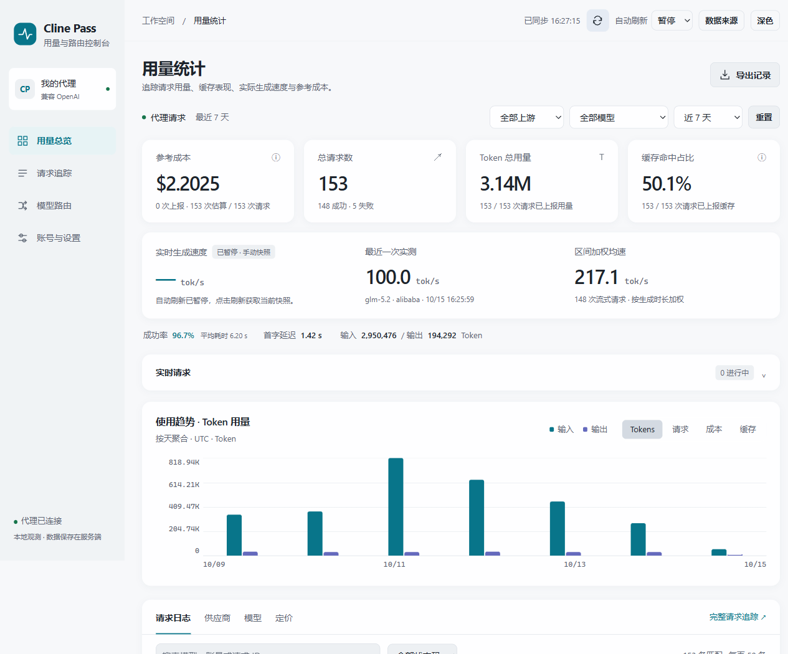
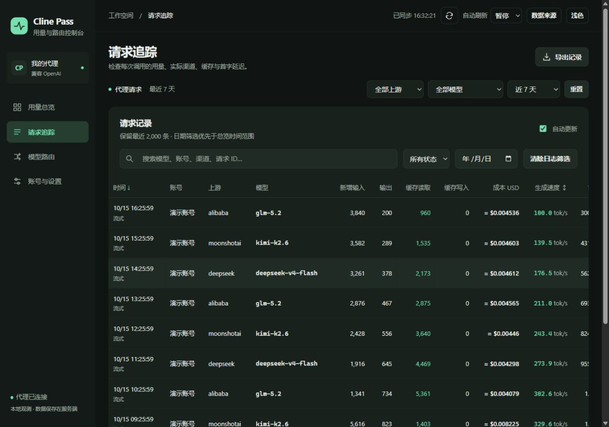

# Cline Pass 控制台

Cline Pass 的本地代理和网页控制台。管理账号、选择上游渠道，查看请求用量、生成速度和参考成本。客户端通过 OpenAI 兼容接口接入。

Node.js ≥ 18，无第三方运行依赖，无需构建。



<details>
<summary>请求追踪与深色主题</summary>



</details>

截图使用本地示例数据，不代表实际用量或订阅账单。

## 启动

```sh
git clone https://github.com/soulxyz/cline-pass-switcher.git
cd cline-pass-switcher
node server.js
```

打开 <http://127.0.0.1:3123/>，进入「账号与设置」，添加 Cline Pass API Key 并保存。不需要先创建配置文件。

客户端填写：

```text
Base URL: http://127.0.0.1:3123/v1
API Key:  控制台设置的代理密钥；未启用鉴权时可填任意非空值
Model:    从控制台订阅模型列表中选择
```

## 功能

- **模型路由**：探测和校验渠道，设置上游优先级、排除项、严格钉住或优先回退。开始返回流式内容后不再切换上游。
- **账号管理**：单账号选择或多账号轮询，支持逐账号测试。
- **用量总览**：Token、缓存、推理用量、首字延迟、实测生成速度、趋势和调用热力图。
- **请求追踪**：按模型、上游、状态和日期筛选，查看重试路径，分页浏览或导出 CSV。
- **参考定价**：优先读取上游成本，也可使用手动单价或 models.dev 报价估算。保留请求发生时的单价和来源。

Token 只采用上游上报的 `usage`，缺失时显示 `—`。参考成本不等于 Cline Pass 订阅扣费。详细计算方式见 [统计口径](docs/metrics.md)。

## Docker

```sh
docker compose up -d --build
```

默认绑定宿主机 `127.0.0.1:3123`，配置和统计保存在 `./data/`。也可以先把 `config.example.json` 复制为 `data/config.json` 再编辑。

需要 Caddy 自动 HTTPS 时，使用 [独立部署配置](deploy/docker-compose.all-in-one.yml)：

```sh
# 域名的 DNS 需指向服务器；以下环境变量写法适用于 sh/bash
CPASS_DOMAIN=pass.example.com docker compose -f deploy/docker-compose.all-in-one.yml up -d --build
```

对外部署前设置代理密钥，并通过 HTTPS 访问。自行配置反向代理时，关闭响应缓冲并延长读取超时，以支持流式输出。

## 配置

大部分设置可以直接在控制台修改。配置文件为 `DATA_DIR/config.json`，默认位于项目根目录。

| 环境变量 | 用途 |
| --- | --- |
| `CLINE_PASS_KEY` | 设置上游账号密钥 |
| `PROXY_KEY` | 设置客户端与控制台共用的代理密钥 |
| `PUBLIC_BASE_URL` | 对外地址，不含 `/v1` |
| `PORT` | 主端口，默认 `3123` |
| `EXTRA_PORTS` | 同时监听的固定备用端口，逗号分隔，如 `18123,18124` |
| `BIND_HOST` | 默认 `127.0.0.1`；容器内为 `0.0.0.0` |
| `DATA_DIR` | 配置、统计与价格缓存目录 |

环境变量在启动时生效；之后通过控制台保存设置，会将当前值写回配置文件。备用端口也可通过 `config.json` 的 `extraPorts` 数组设置。主端口不可用时可访问备用端口，所有端口均失败则退出。

`config.json` 含明文密钥，统计与缓存也属于本地运行数据，均已排除出 Git。分享文件前请检查内容。探测、测试和校验会向上游发出真实请求，可能消耗额度。

## 开发

```sh
npm run check  # 服务端与前端语法检查
npm test       # 使用本地模拟上游验证代理、统计、定价和备用端口
```

前端是原生 HTML/CSS/JavaScript，修改后刷新页面即可；服务端修改后需重启。界面约定见 [DESIGN_SYSTEM.md](DESIGN_SYSTEM.md)。

## 来源与许可

本项目基于 [munmunjaklin458-afk/cline-pass-switcher](https://github.com/munmunjaklin458-afk/cline-pass-switcher)，在其账号与上游路由功能上增加用量统计、定价和新版控制台。

[MIT License](LICENSE)
